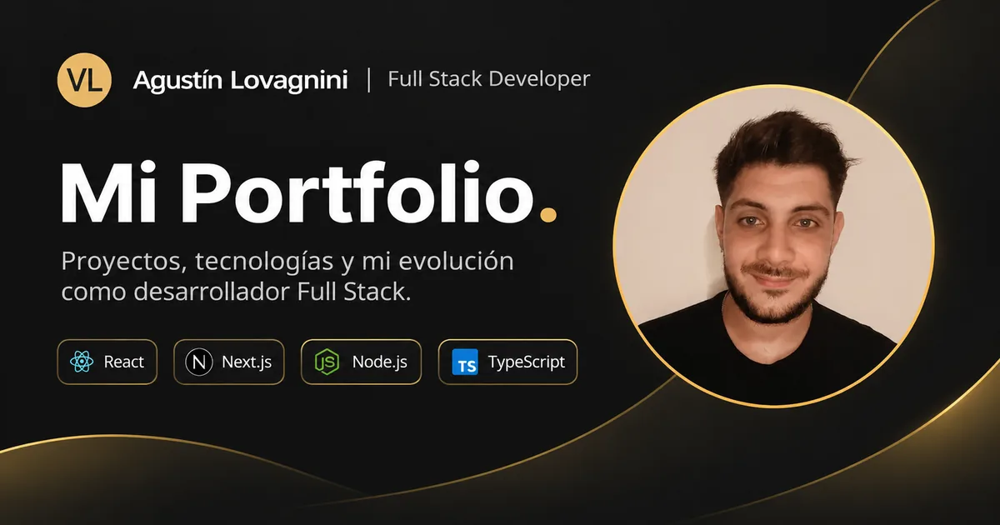
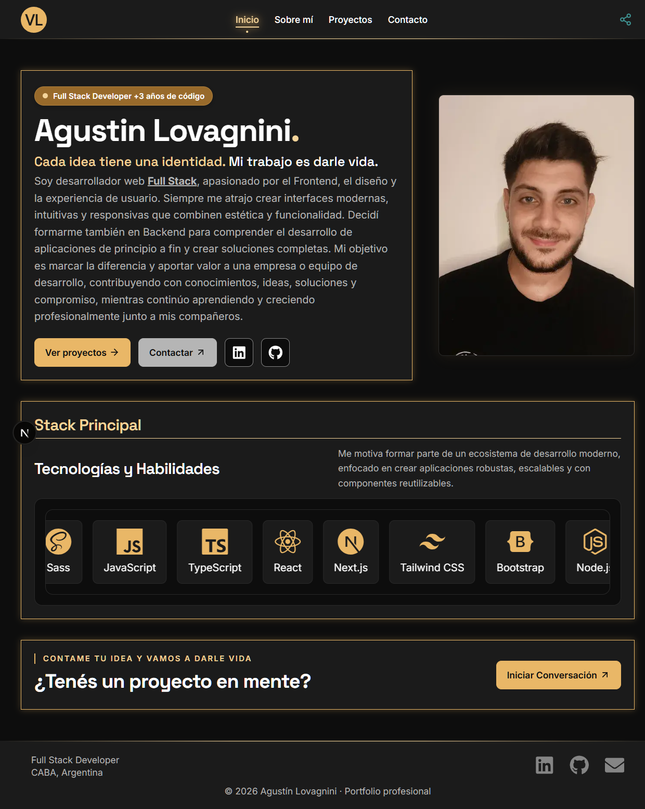
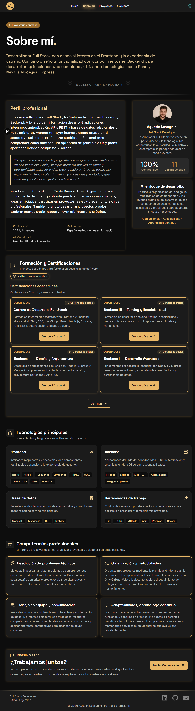
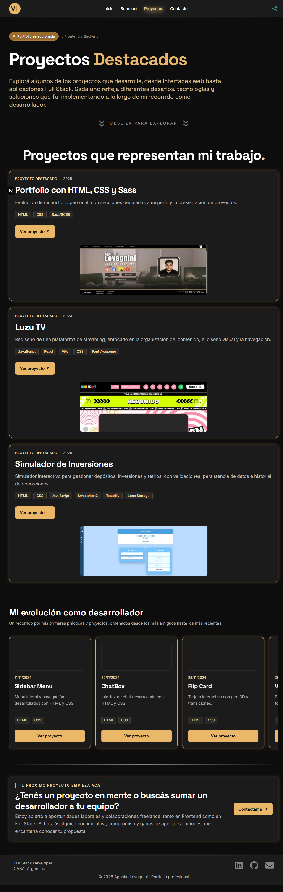
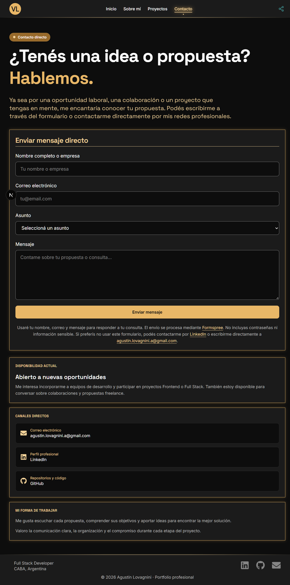
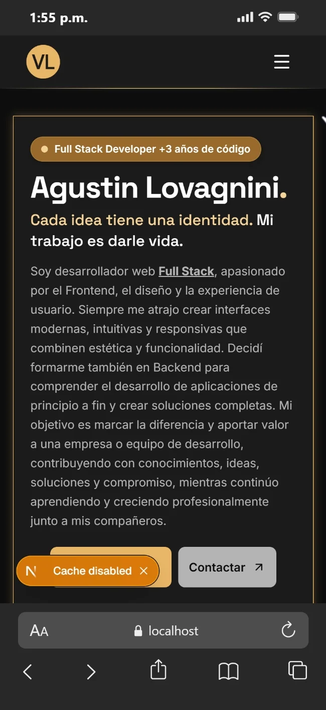
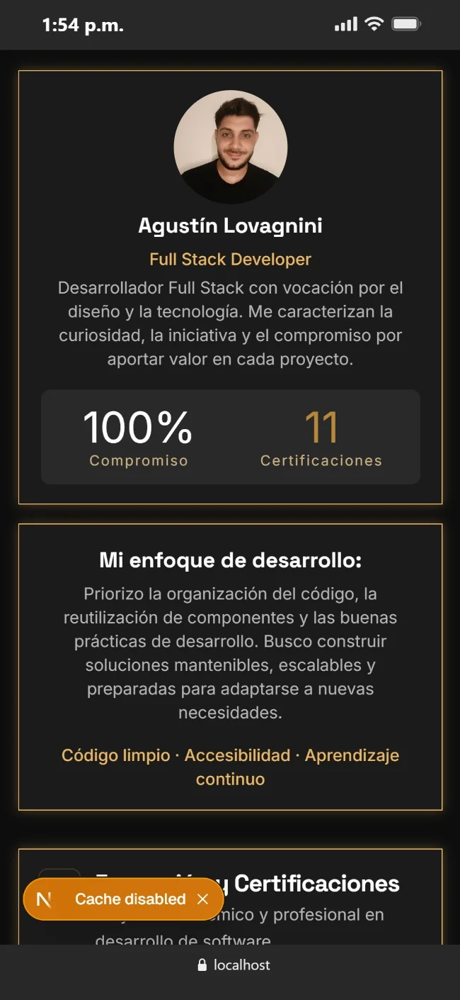
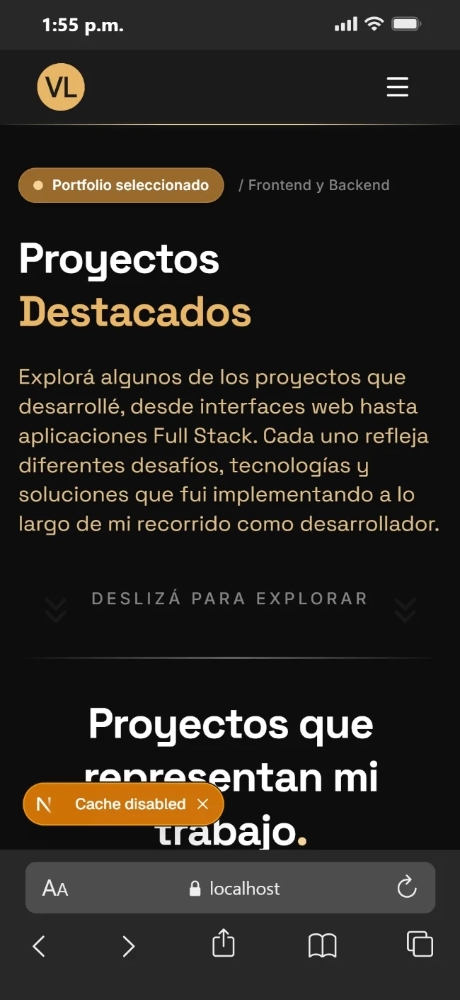
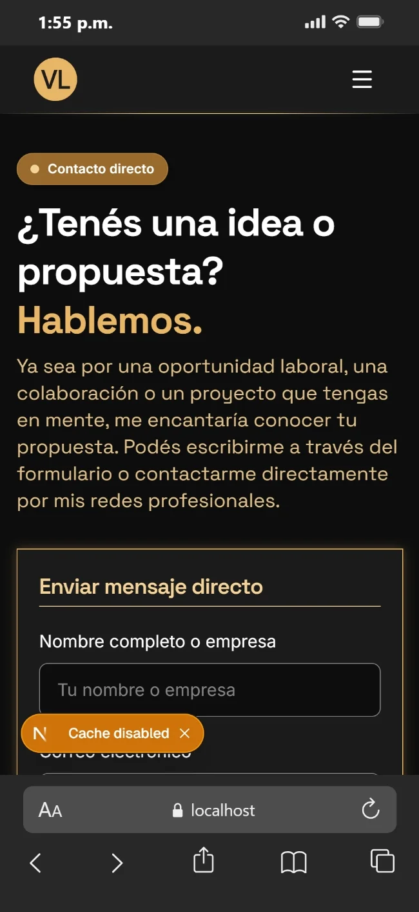

# Portfolio profesional · Agustín Lovagnini



Portfolio personal desarrollado con **Next.js, React, TypeScript y Tailwind CSS**. Reúne mi perfil profesional, formación, certificaciones y proyectos de desarrollo web, con una interfaz oscura y detalles dorados.

[Capturas](#capturas-de-pantalla) · [Instalación](#instalación-y-ejecución-local) · [Contacto](#contacto)

> **Estado:** proyecto integrado en `main`, con lint, build y pruebas manuales de producción local completados por el autor. Publicación pendiente; el enlace se agregará después del despliegue.

## Sobre el proyecto

Soy Agustín Lovagnini, desarrollador Full Stack con especial interés en el Frontend, el diseño y la experiencia de usuario. Este portfolio presenta mi trabajo a equipos de desarrollo, reclutadores y personas interesadas en colaborar.

También representa la evolución de mi [portfolio anterior con HTML, CSS y Sass](https://github.com/agustin-lovagnini/agustin-lovagnini-cv-web) y mi aprendizaje práctico de React, Next.js y TypeScript.

## Funcionalidades

- Cuatro páginas con navegación compartida y menú móvil.
- Perfil profesional, tecnologías, competencias y certificaciones desplegables.
- Catálogo de 12 proyectos: tres destacados y nueve prácticas ordenadas cronológicamente.
- Formulario de contacto integrado con Formspree y canales de contacto directos.
- Botón para compartir el portfolio o copiar su enlace, según las funciones del navegador.
- Metadatos por página y portada para compartir mediante Open Graph y Twitter Cards.
- Diseño responsive, imágenes con `next/image` y reglas para respetar la preferencia de movimiento reducido.

## Páginas

| Página | Ruta | Contenido |
| --- | --- | --- |
| Inicio | `/` | Presentación, stack principal y accesos a proyectos y contacto. |
| Sobre mí | `/sobre-mi` | Perfil, formación, certificaciones, tecnologías y competencias. |
| Proyectos | `/proyectos` | Proyectos destacados y recorrido por mis primeras prácticas. |
| Contacto | `/contacto` | Formulario, disponibilidad y redes profesionales. |

## Capturas de pantalla

Capturas proporcionadas por el autor durante el desarrollo local. Los indicadores de Next.js y las barras del navegador visibles en algunas imágenes pertenecen al entorno de captura.

### Escritorio

Vista de Inicio. Abrí la imagen para verla en tamaño completo.

[](docs/screenshots/desktop-home.webp)

<details>
<summary>Ver Sobre mí, Proyectos y Contacto en escritorio</summary>

#### Sobre mí



#### Proyectos



#### Contacto



</details>

### Móvil

| Inicio | Sobre mí |
| :---: | :---: |
|  |  |

| Proyectos | Contacto |
| :---: | :---: |
|  |  |

## Tecnologías

| Tecnología | Uso |
| --- | --- |
| Next.js · App Router | Rutas, layout compartido, metadatos y generación de páginas. |
| React | Componentes e interacciones. |
| TypeScript | Tipado de componentes y catálogos de datos. |
| Tailwind CSS v4 y CSS | Diseño responsive, estilos compartidos y animaciones. |
| Lucide React y React Icons | Iconografía. |
| Formspree | Procesamiento del formulario de contacto, sin backend propio. |
| Git, GitHub y npm | Versionado y gestión de dependencias. |

La identidad visual combina **Inter** para textos y **Space Grotesk** para títulos, fondo `#0D0D0D` y dorado principal `#E9B767`.

## Instalación y ejecución local

Requisitos: **Node.js 20.9 o superior**, según el requisito de Next.js instalado, y **npm**. Para un entorno nuevo, usar una versión LTS compatible.

```bash
git clone https://github.com/agustin-lovagnini/agustin-lovagnini-cv.git
cd agustin-lovagnini-cv
npm ci
npm run dev
```

Abrir **http://localhost:3000**. Para detener el servidor, presionar `Ctrl + C`.

En Windows, si PowerShell bloquea `npm.ps1`, ejecutar los comandos con `npm.cmd`, por ejemplo `npm.cmd run dev`.

### Comandos disponibles

| Comando | Función |
| --- | --- |
| `npm ci` | Instala las dependencias a partir de `package-lock.json`. |
| `npm run dev` | Inicia el entorno de desarrollo. |
| `npm run lint` | Ejecuta ESLint. |
| `npm run build` | Compila la aplicación para producción y comprueba TypeScript. |
| `npm run start` | Sirve la compilación de producción; requiere un build previo. |

### Ver desde el celular

Conectar la computadora y el celular a la misma red Wi-Fi e iniciar:

```bash
npm run dev -- --hostname 0.0.0.0
```

Abrir desde el celular la dirección **Network** que indique Next.js. Si se bloquean los recursos de desarrollo, revisar que la IP actual esté incluida en `allowedDevOrigins` en `next.config.ts` y reiniciar el servidor. Esto permite acceso desde la red local; no publica el sitio en Internet.

### URL pública y metadatos

El layout lee la variable de entorno `SITE_URL` para construir las URL absolutas de los metadatos y de la portada para compartir. En desarrollo utiliza `http://localhost:3000` si no está configurada.

Antes de desplegar, configurar `SITE_URL` en el hosting con la dirección pública completa, incluyendo `https://`, y generar un nuevo build. El valor debe corresponder al dominio real del sitio.

Para probarla localmente, puede definirse en `.env.local`. Los archivos `.env*` están excluidos de Git.

## Estructura del repositorio

```text
app/                    Páginas, layout, metadatos, estilos base e iconos
components/
├── layout/             Header, Footer y navegación móvil
├── projects/           Tarjetas y marquesina de proyectos
├── certifications/     Tarjetas y listado de certificaciones
└── ui/                 Componentes compartidos de interfaz
data/                   Catálogos de proyectos, tecnologías y certificaciones
styles/                 Estilos compartidos y animaciones
public/images/          Retratos, logo, portada Open Graph y proyectos
docs/screenshots/       Capturas utilizadas en este README
```

Los catálogos se mantienen separados de la presentación. Los componentes con CSS propio lo guardan junto a su TSX; las hojas se importan desde `app/globals.css` y conservan clases globales.

## Estado y próximos pasos

Verificaciones aportadas por el autor el **14 de noviembre de 2026**:

- [x] Metadatos generales, por página y portada para compartir incorporados.
- [x] ESLint y build de producción completados sin errores.
- [x] Navegación, menú móvil, enlaces, formulario y portada comprobados manualmente en producción local.
- [x] Desarrollo integrado y subido a `main`.
- [ ] Configurar la URL pública y completar sitemap, robots y URL canónicas.
- [ ] Completar la revisión de accesibilidad y las mediciones con Lighthouse.
- [ ] Revisar dependencias y configuración final del hosting.
- [ ] Publicar y comprobar HTTPS, formulario, metadatos y enlaces en la URL pública.

El seguimiento técnico detallado y las pautas de colaboración están en [AGENTS.md](AGENTS.md).

## Contacto

**Agustín Lovagnini · Full Stack Developer · CABA, Argentina**

- [LinkedIn](https://www.linkedin.com/in/agustinlovagnini/)
- [GitHub](https://github.com/agustin-lovagnini)
- [agustin.lovagnini.a@gmail.com](mailto:agustin.lovagnini.a@gmail.com)

Proyecto personal desarrollado como parte de mi formación y crecimiento profesional.
